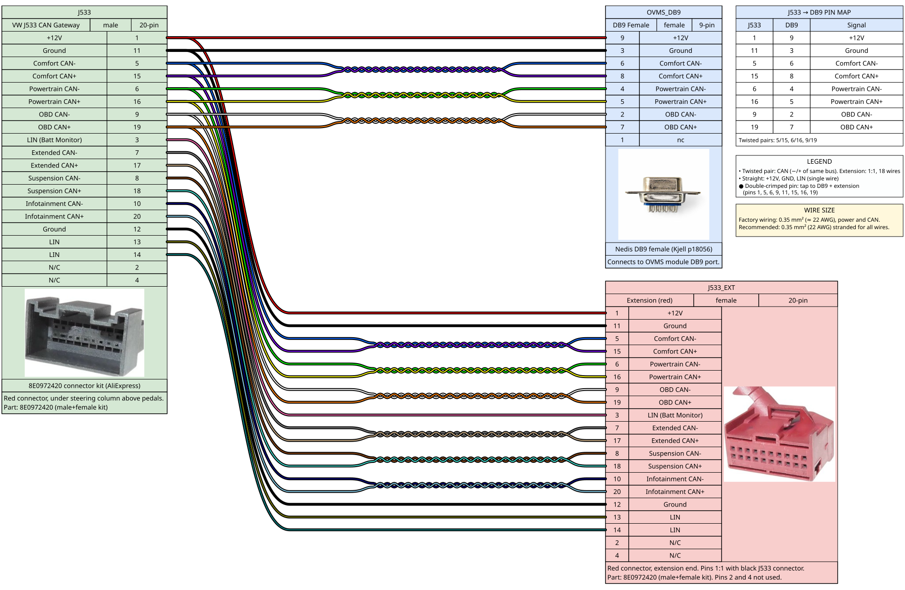
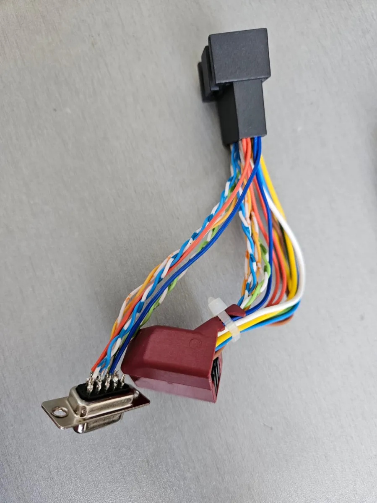
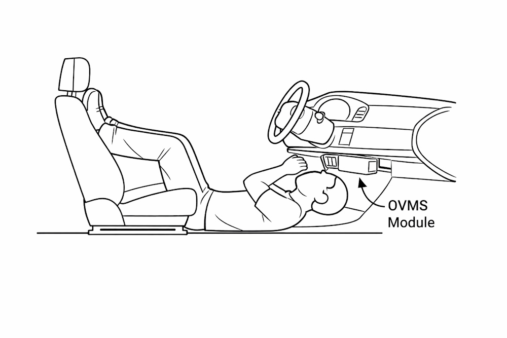
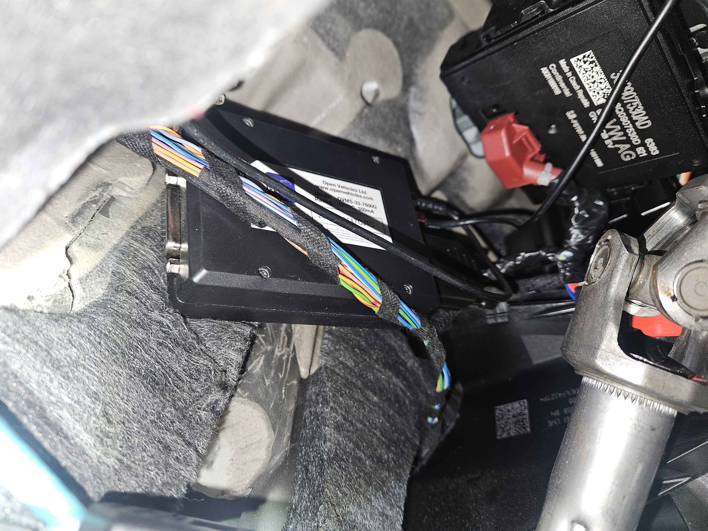

=========
VW e-Golf
=========

Vehicle Type: **VWEG**

This vehicle type supports the VW e-Golf.
Connection is made via the J533 gateway module, preferably using a harness
adapter that plugs into the existing connector.

-------
Adapter
-------

The adapter connects to the J533 gateway harness connector, giving access to
the Comfort CAN (KCAN) and Powertrain CAN (FCAN) buses.  Everything the module
reads arrives on KCAN: the J533 gateway rebroadcasts the powertrain/HV frames
(VIN, gear selector, SoC, pack current/voltage, speed) onto KCAN, so a single
KCAN tap sees them all.  The module therefore registers KCAN only; FCAN is
present on the adapter but not used.

The adapter extends the car harness — pins are connected straight through,
with the CAN pairs run as twisted pair (e.g. from CAT6 cable).  The
connector part number is VW 8E0972420 (buy both male and female).

------------
Installation
------------

Installation does not require removal of any trim pieces.
The J533 gateway module is located under the steering wheel, above the pedals.
Position yourself face-up under the dashboard — you should see the gateway
module with its red connector from there.

Unplug the red connector, plug in the adapter, connect the OVMS module to the
adapter, and tuck it somewhere in the dashboard.

-------------------
Basic Configuration
-------------------

After selecting the VW e-Golf vehicle module, data should start flowing in
once the car is awake.

----------------
Support Overview
----------------

=========================== ==============
Function                    Support Status
=========================== ==============
Hardware                    Any OVMS v3 (or later) module. Vehicle support: 2014–2020
Vehicle Cable               Harness adapter for J533 gateway module (see above)
GSM Antenna                 1000500 Open Vehicles OVMS GSM Antenna (or compatible)
GPS Antenna                 1020200 Universal GPS Antenna (or compatible)
SOC Display                 Yes
Range Display               Yes
Cabin Pre-heat/cool Control Yes
GPS Location                Yes (decoded from KCAN frame 0x486)
Speed Display               Yes
Temperature Display         Yes (see list of metrics below)
BMS v+t Display             No
TPMS Display                No
Charge Status Display       Yes
Charge Interruption Alerts  No
Charge Control              Charge-current limit, start/stop (see below)
Lock/Unlock Vehicle         No
Valet Mode Control          No
12V Charging Status         Yes (``v.e.charging12v``, see below)
Others
=========================== ==============

-------------------
12V Charging Status
-------------------

* ``v.e.charging12v`` is set while the DC-DC converter charges the 12V battery. The e-Golf has no alternator, so
  this is whenever the HV system is up: the HV-system-active bit of KCAN frame 0x187 (bit 15, ``HV_Bordnetz_aktiv``
  of ``Motor_EV_01`` in opendbc), HV charging in progress, or remote climate running. It clears when KCAN goes silent
* OVMS Power Management (``power`` config) relies on this metric to tell whether the 12V battery is being charged

---------------------
Cabin Climate Control
---------------------

* Temperature setpoint is set in the car's infotainment system (e-Manager)
* Climatise on battery power is force-enabled
* OVMS may show the car as charging/plugged-in even if it is not charging/plugged-in
* Front windscreen heating can be included in pre-conditioning with ``xvg charge profile set 0 frontwindow on``
  (``off`` to disable). The setting is stored in the car and applies to every climate start until it is changed;
  it can also be changed while climate is running. ``xvg charge profile list`` shows it as ``fw`` on profile 0.
  The car's infotainment has no equivalent setting
* The windscreen heating will not turn on unless the outside temperature is below 4 °C, even when the option is
  enabled. This threshold is set in the HVAC module (08) adaptation
  "IDE07303-Rem.start funct.:activ.temper. of windshield defrost.heat." (default 4 °C) and cannot be changed by OVMS
* The metric ``xvg.v.env.heated_front_window`` shows whether windscreen heating is active as part of remote
  pre-conditioning. It does not reflect the windscreen heater button on the dashboard
* The windscreen heater uses additional energy, which reduces range when climatising on battery power

--------------
Charge Control
--------------

Charge control only applies to the default settings in the car, not the user defined charge locations/departure timers.

This means:

* Current limit does not apply by default if you have departure timers enabled because the car will not use the default settings.
* The moment you use the charge control feature the car will switch to the default charge profile, charging it to 100% SoC
* You cannot switch back to your departure timer via OVMS, press the delayed charging button on the charge port

Furthermore to make it compatible with climate control:

* When climate control is started while charging you have to turn off climate control first before you can stop charging
* Enabling climate control while plugged in will cause the car to start charging again
* To avoid climate preconditioning from starting when using the charge start command while unplugged the flag "climatise on battery" is cleared

Charge current limit only supports a few set values: 5A, 10A, 13A or 32A (= Max)
